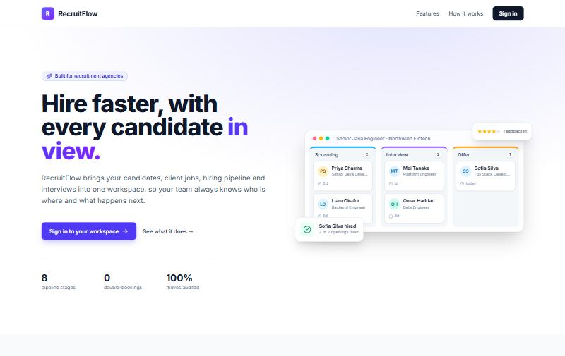
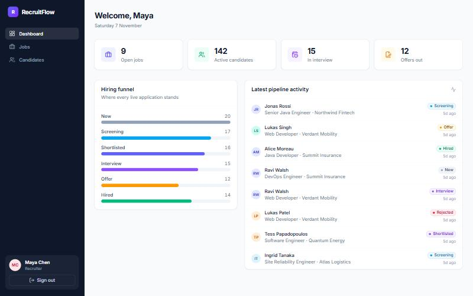
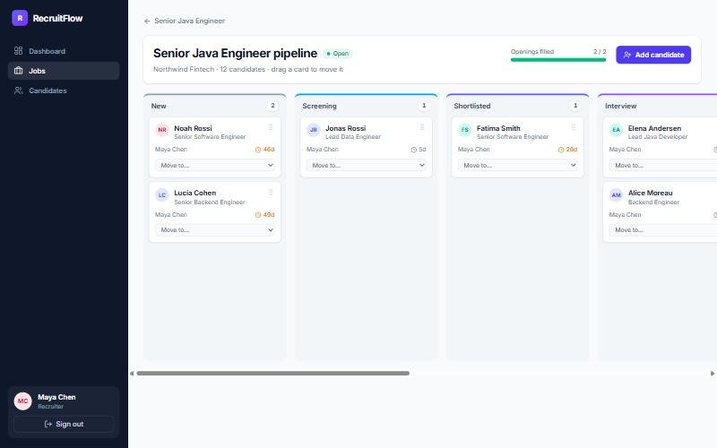
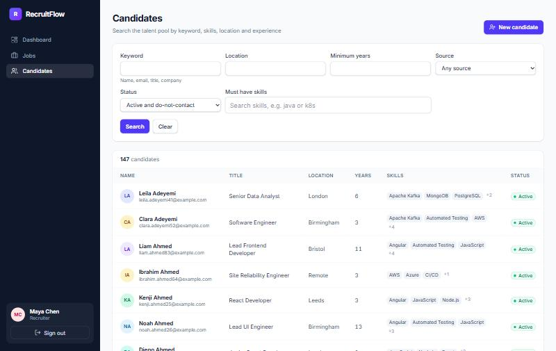
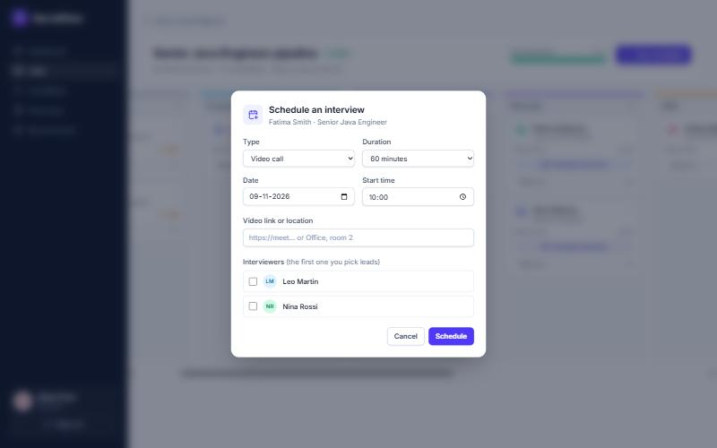
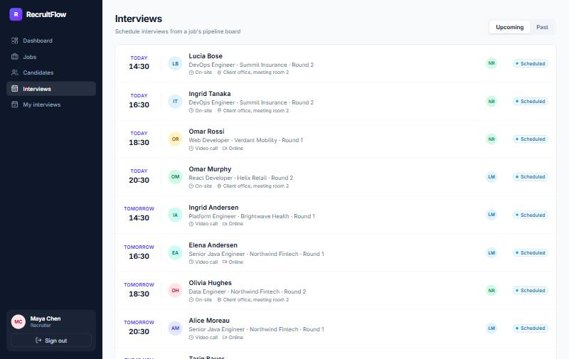
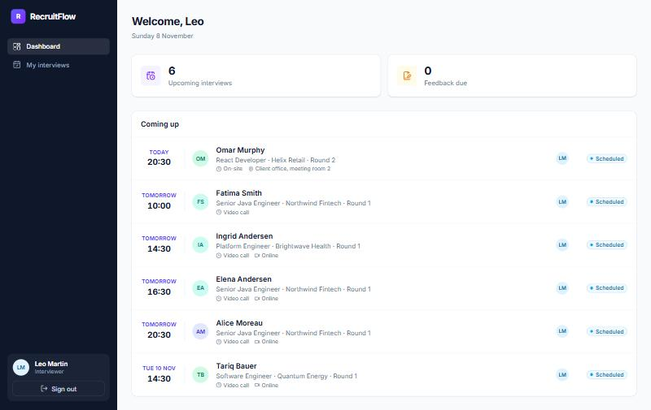
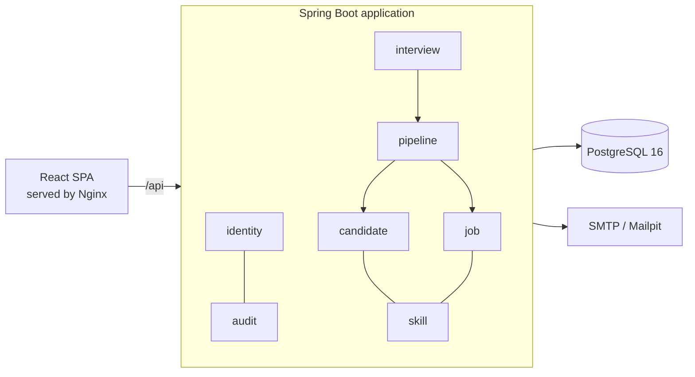

<div align="center">

# RecruitFlow

**Recruitment operations and applicant tracking for agencies**

Candidates, client jobs, a visual hiring pipeline, interviews and blind feedback in one workspace.


[](https://github.com/sudhanshushekar898/recruitflow/actions/workflows/ci.yml)

</div>



## Contents

- [Why RecruitFlow](#why-recruitflow)
- [Screenshots](#screenshots)
- [Features](#features)
- [Tech stack](#tech-stack)
- [Architecture](#architecture)
- [Engineering highlights](#engineering-highlights)
- [Getting started](#getting-started)
- [Running the tests](#running-the-tests)
- [API documentation](#api-documentation)
- [Project structure](#project-structure)
- [Security and privacy](#security-and-privacy)
- [Roadmap](#roadmap)
- [License](#license)

## Why RecruitFlow

Small recruitment agencies juggle candidates, client roles and interview panels across spreadsheets and inboxes. RecruitFlow gives a team of around ten recruiters, interviewers and admins one place to:

- keep a searchable talent pool with skills, notes and consent records,
- run each client job through a visual pipeline where only legal moves are possible,
- book interview panels without double-booking anyone,
- collect structured, blind feedback, and
- see at a glance where hiring is stalling.

## Screenshots

| Recruiter dashboard | Pipeline board |
|---|---|
|  |  |
| **Candidate search** | **Scheduling an interview** |
|  |  |
| **All interviews** | **Interviewer's dashboard** |
|  |  |

## Features

**Candidates and skills**
- Candidate profiles with skills (years and level), notes, source, owner and status (active, archived, do-not-contact).
- A skill catalogue with aliases, so `k8s` finds Kubernetes and `postgres` finds PostgreSQL.
- Search by keyword, location, minimum experience, source and must-have skills, with paging and sorting.
- Duplicate detection by email, case-insensitive, linking to the existing record.
- Consent and retention: legal basis, evidence and a retention date driven by consent expiry.

**Clients and jobs**
- Client companies and job postings with salary range, openings and weighted skill requirements.
- A job lifecycle (draft, open, on hold, closed, reopened) with enforced transitions.
- Only the owning recruiter or an admin can change a job; everyone with access can read it.

**Hiring pipeline**
- A drag-and-drop board per job: New, Screening, Shortlisted, Interview, Offer, Hired, plus Rejected and Withdrawn.
- A state machine that permits only legal moves. The server tells the UI which moves the signed-in user may make.
- Making an offer, hiring and reopening a rejection are reserved for the application's owner or an admin.
- Rejections require a reason. Every move is stored in an append-only history.
- Candidates sitting in a stage for more than 14 days are flagged, and hiring the last opening suggests closing the job.

**Interviews and feedback**
- Schedule from the pipeline board: type, time, duration, link or location, and the interviewer panel.
- Booking moves a shortlisted candidate to the Interview stage automatically.
- Clash detection refuses double-booking an interviewer, even when two recruiters book at the same moment.
- Interviewers see only their own interviews and never a candidate's contact details.
- Feedback is structured (1–5 rating, recommendation, strengths, concerns) and blind until you submit your own.

**Accounts and security**
- Sign-in with short-lived JWT access tokens and rotating refresh tokens, with reuse detection.
- Roles: Admin, Recruiter, Interviewer. Admins invite users by email, and invitees set their own password.
- Account lockout after repeated failures, forced password change for the bootstrap admin, and password reset by email.
- An append-only audit log of security-relevant and data-changing actions.

## Tech stack

| Layer | Technology |
|---|---|
| Backend | Java 21, Spring Boot 3.5, Spring Security (OAuth2 Resource Server, RS256 JWT), Spring Data JPA / Hibernate |
| Database | PostgreSQL 16, Flyway migrations, `pg_trgm` trigram search |
| Frontend | React 19, TypeScript (strict), Vite, Tailwind CSS 4, TanStack Query, React Router, React Hook Form + Zod, lucide icons |
| API contract | OpenAPI 3 (springdoc), with TypeScript types generated from the spec |
| Testing | JUnit 5, Mockito, AssertJ, Testcontainers, ArchUnit, Vitest, Testing Library, MSW |
| Delivery | Docker, Docker Compose, Nginx, GitHub Actions CI |

## Architecture

RecruitFlow is a **modular monolith**: one Spring Boot deployable and one PostgreSQL database, split into modules with strict boundaries.



- **Modules:** `identity`, `audit`, `skill`, `candidate`, `job`, `pipeline` and `interview`, plus a `shared` kernel.
- **Layers:** each module is a package with `api → service → domain → repository` layers and a small public facade.
- **Boundaries:** modules refer to each other only by ID and through facades, never through JPA associations. [ArchUnit](backend/src/test/java/dev/recruitflow/ArchitectureTest.java) tests enforce these rules on every build.
- **Further reading:** the full design is in [docs/ARCHITECTURE.md](docs/ARCHITECTURE.md), covering requirements, ER diagrams, API contracts, security and the roadmap. Key decisions are recorded as [ADRs](docs/adr).

## Engineering highlights

- **Race-safe by design.**
  - Duplicate candidates and duplicate applications are prevented by database unique constraints. The losing request in a race gets a clean `409`, never a `500`.
  - Interview clash detection takes transaction-scoped PostgreSQL advisory locks per interviewer, so simultaneous bookings serialize.
  - Concurrency tests prove each of these.
- **An exhaustively tested state machine.** Every one of the 64 status pairs is checked against an independently written transition table.
- **Search that scales.** Keyword search uses a generated, trigram-indexed column. A test seeds 100,000 candidates and asserts that the query planner uses the index and the median response stays under 300 ms.
- **Token security.**
  - Access tokens live only in memory.
  - Refresh tokens are opaque, hashed at rest, rotated on every use, and revoke their whole family when a used token is replayed.
  - Concurrent refreshes in the SPA are single-flight.
- **Optimistic locking everywhere a user edits.** A stale edit returns `409 STALE_VERSION` instead of silently overwriting a colleague's change.
- **Consistent errors.** Every error is RFC 7807 `problem+json` with a stable error code and a correlation ID, and never leaks a stack trace.
- **Realistic demo data.** A deterministic seeder generates clients, jobs, 150 candidates, applications with a backdated pipeline history, interviews and feedback, all synthetic with `example.com` addresses.

## Getting started

### Prerequisites

- Docker Desktop

That's all you need to run the app. For local development you also need Java 21 and Node.js 22 or later.

### Run everything with Docker

```bash
git clone https://github.com/sudhanshushekar898/recruitflow.git
cd recruitflow
docker compose --profile full up -d --build
```

Then open:

| What | URL |
|---|---|
| The app | http://localhost:8081 |
| API docs (Swagger UI) | http://localhost:8080/swagger-ui.html |
| Test inbox (invite and reset emails) | http://localhost:8025 |

The first start creates the database schema and loads the demo data. It takes about a minute.

### Demo accounts

All demo data is synthetic.

| Role | Email | Password |
|---|---|---|
| Recruiter | `maya.chen@demo.recruitflow.local` | `Demo-Passphrase-2026` |
| Recruiter | `tomas.novak@demo.recruitflow.local` | `Demo-Passphrase-2026` |
| Recruiter | `aisha.khan@demo.recruitflow.local` | `Demo-Passphrase-2026` |
| Interviewer | `leo.martin@demo.recruitflow.local` | `Demo-Passphrase-2026` |
| Interviewer | `nina.rossi@demo.recruitflow.local` | `Demo-Passphrase-2026` |
| Admin | `admin@recruitflow.local` | `Local-Admin-Pass-2026`, which you must change at first sign-in |

To reset to a fresh database:

```bash
docker compose --profile full down -v
```

### Develop locally

```bash
docker compose up -d                                        # PostgreSQL and Mailpit only
cd backend && ./mvnw spring-boot:run -Dspring-boot.run.profiles=local
cd frontend && npm ci && npm run dev                        # http://localhost:5173 (proxies /api)
```

## Running the tests

```bash
cd backend && ./mvnw verify      # unit, integration (Testcontainers), architecture rules, 80% coverage gate
cd frontend && npm test          # component and API-client tests
cd frontend && npm run lint && npm run typecheck
```

The backend has 182 tests and the frontend has 54. Integration tests run against a real PostgreSQL in Docker, never an in-memory substitute. GitHub Actions runs the same checks on every push and pull request.

## API documentation

The REST API lives under `/api/v1`. It is documented with OpenAPI and browsable in Swagger UI when the app runs with the `local` profile. The main resources are:

| Resource | Endpoints |
|---|---|
| Auth | `POST /auth/login`, `/auth/refresh`, `/auth/logout`, `/auth/change-password`, `/auth/accept-invite`, `/auth/forgot-password`, `/auth/reset-password`, `GET /auth/me` |
| Users (admin) | `GET/POST /users`, `GET/PATCH /users/{id}`, `PUT /users/{id}/roles`, `POST /users/{id}/deactivate` |
| Skills | `GET/POST /skills` |
| Candidates | `GET/POST /candidates`, `GET/PATCH /candidates/{id}`, `/archive`, `/restore`, `/skills`, `/notes`, `/consent`, `/applications` |
| Clients and jobs | `GET/POST /clients`, `GET/POST /jobs`, `GET/PATCH /jobs/{id}`, `/skills`, `/status`, `/pipeline` |
| Applications | `GET/POST /applications`, `GET /applications/{id}`, `POST /applications/{id}/status`, `GET /applications/{id}/history` |
| Interviews | `GET/POST /interviews`, `GET /interviews/mine`, `GET/PATCH /interviews/{id}`, `/cancel`, `/complete`, `GET/POST /interviews/{id}/feedback` |

The full contract, including request and response examples and the error-code catalogue, is in [docs/ARCHITECTURE.md §7](docs/ARCHITECTURE.md).

## Project structure

```
recruitflow/
├── backend/                     Spring Boot application
│   └── src/main/java/dev/recruitflow/
│       ├── shared/              errors, paging, persistence base, web filters
│       ├── identity/            users, roles, JWT, refresh tokens, invites
│       ├── audit/               append-only audit log
│       ├── skill/               skill catalogue and aliases
│       ├── candidate/           candidates, notes, consent, search
│       ├── job/                 clients, jobs, lifecycle
│       ├── pipeline/            applications, state machine, history
│       ├── interview/           scheduling, clash detection, feedback
│       └── demo/                synthetic demo-data seeder
│   └── src/main/resources/db/migration/   Flyway migrations V1–V8
├── frontend/                    React + TypeScript SPA
│   └── src/
│       ├── app/                 routing, layout, dashboard
│       ├── components/          design-system components
│       ├── features/            auth, candidates, jobs, interviews, landing, users
│       └── lib/                 API client, auth store, form helpers
├── docs/                        architecture, ADRs, screenshots
├── docker-compose.yml
└── .github/workflows/ci.yml
```

## Security and privacy

- **Authorization:** deny-by-default routes, role checks on every service method, and object-level checks (job owner, interview panel member).
- **Passwords:** stored with BCrypt (cost 12) behind a delegating encoder. Tokens are never logged.
- **Candidate data:** treated as personal data.
  - Each candidate has a recorded legal basis and a retention date.
  - Interviewers never see contact details.
  - The logs contain IDs only, never emails, phones or request bodies.
- **Audit log:** append-only, enforced by a database trigger.
- **Responsible disclosure:** please report security issues privately rather than in a public issue.

## Roadmap

- [x] Foundation, authentication and user management
- [x] Candidates, skills and search
- [x] Clients, jobs and the hiring pipeline
- [x] Interviews and blind feedback
- [ ] Resume upload and S3 file storage
- [ ] Audit log viewer and security hardening (rate limiting, CSP)
- [ ] Analytics: funnel conversion and time to hire
- [ ] Email notifications through a transactional outbox
- [ ] Deployment to AWS (ECS Fargate, RDS, S3, CloudFront)
- [ ] Explainable candidate–job skill matching

## License

Released under the [MIT License](LICENSE). Built by **sudha** ([@sudhanshushekar898](https://github.com/sudhanshushekar898)).
