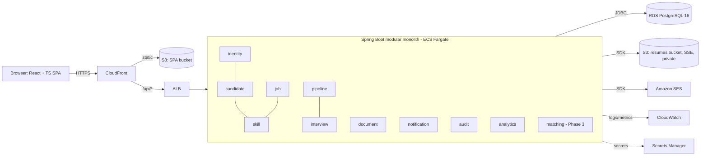
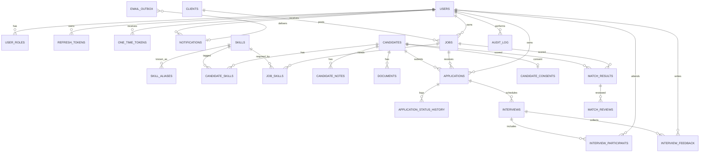
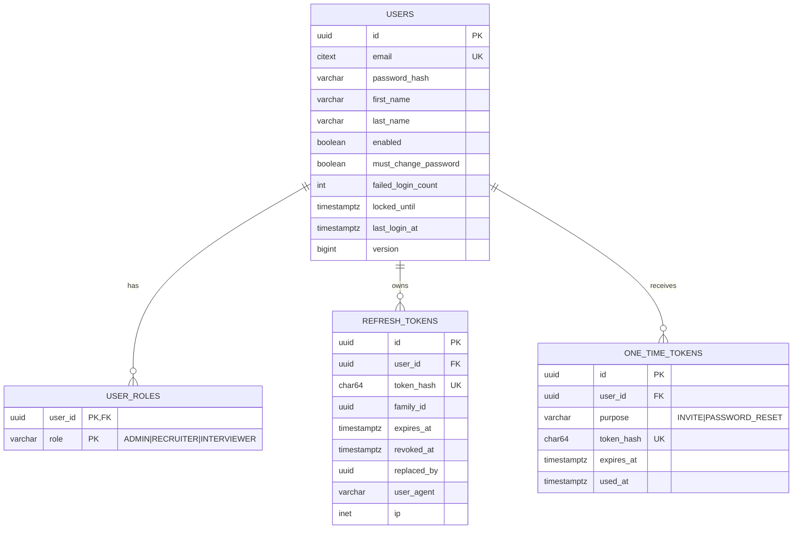
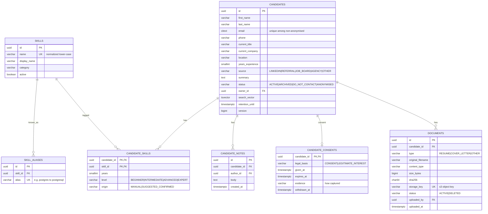
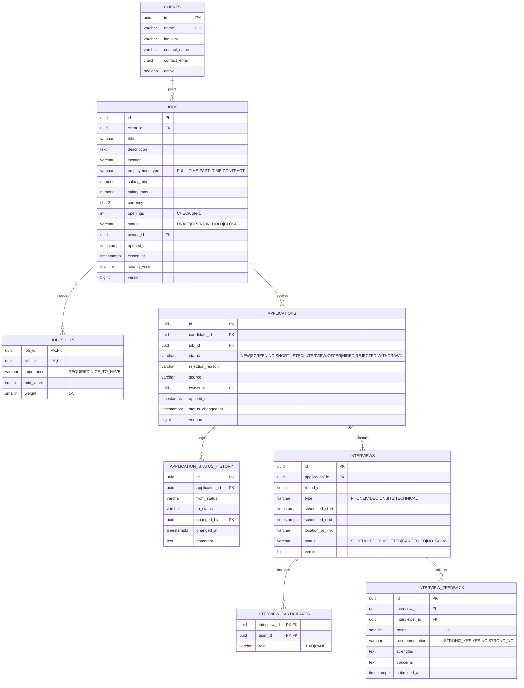
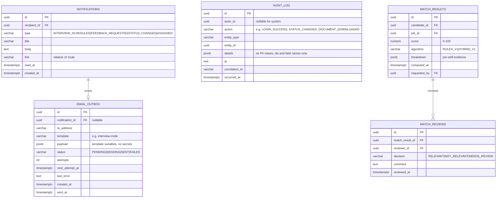
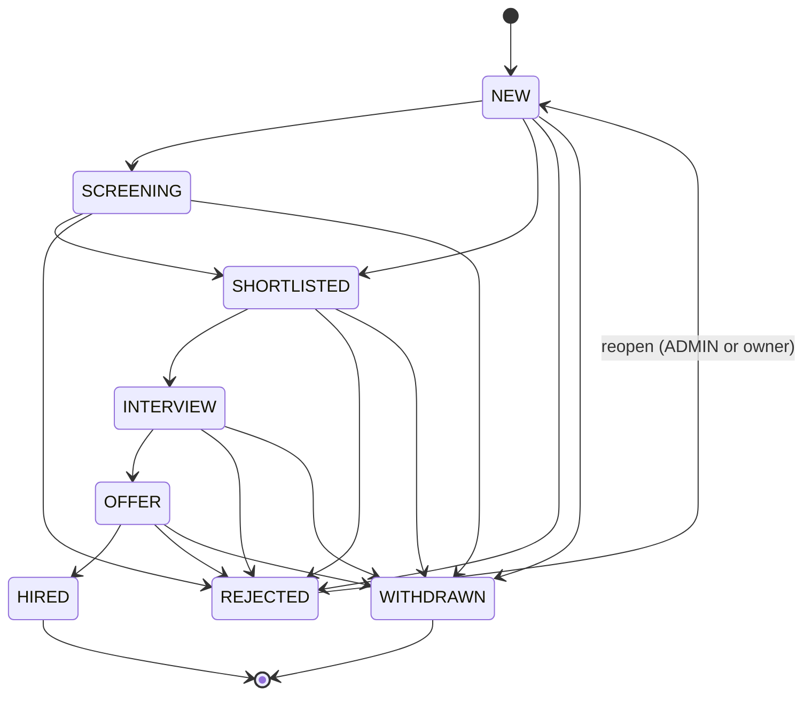
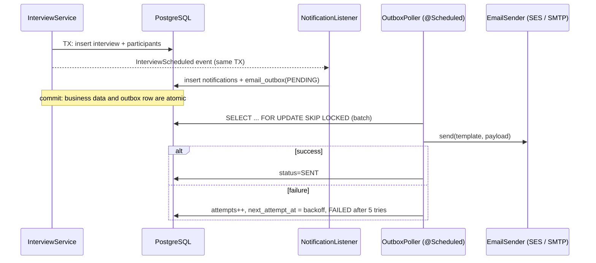

# RecruitFlow: Final Architecture Document (v2.0, for approval)

Status: **PROPOSAL. No application code exists yet.** Implementation starts only after approval (see section 18).
Supersedes: the earlier "Recruitment CRM" architecture proposal (v1).

---

## 0. What changed from v1 and why

| # | v1 | v2 | Reason |
|---|---|---|---|
| 1 | Flat feature list | **Must / Should / Optional** tiers and three delivery phases | Guarantees a finished, demonstrable core before any advanced feature |
| 2 | Skills were free-text tags | **Normalized `skills` catalog**, `candidate_skills`, `job_skills` (required vs nice-to-have, weight) | Needed for search facets, analytics and explainable matching. Free text cannot be matched reliably |
| 3 | Documents were "post-MVP, local disk" | **Document module on AWS S3**, server-validated upload, short-lived presigned download, MinIO locally | Required by the brief and a strong AWS demonstration |
| 4 | Notifications deferred | **Notification module**: in-app notifications plus **transactional-outbox email** sent asynchronously through SES | Reliable async without Kafka or a broker. Postgres is the queue |
| 5 | Audit was a shared table | **Audit module** (append-only), separate from business history tables | Clear ownership, an admin query API, and tamper-resistance |
| 6 | Privacy mentioned briefly | **Section 11: dedicated privacy and security requirements** (consent, retention, erasure, minimisation, access logging, field-level restrictions) | Candidate data is personal data. Reviewers look for this |
| 7 | AI not covered | **Matching module (Phase 3 only)**, explainable and advisory, with a deterministic baseline before any ML/LLM | Impressive but safe. No automated decisions |
| 8 | Custom JWT filter | **Spring Security OAuth2 Resource Server** (Nimbus) validating our own RS256 JWTs | Less custom security code, fewer bugs, and a well-known pattern |
| 9 | "Deploy target TBD" | **AWS target architecture** (ECS Fargate, RDS, S3, SES, CloudFront, Secrets Manager, OIDC from GitHub Actions) plus a cheap Compose fallback | Required by the stack. Cost-conscious |
| 10 | Module `application` clashed with layer name | Module renamed **`pipeline`** | Removes ambiguity (REST path remains `/applications`) |
| 11 | Open questions left unanswered | **Decisions recorded as ADRs (section 16)** with defaults, so the plan is actionable | Questions that remain are listed in section 18 |
| 12 | Milestones were a flat list | **Phased milestones with exit criteria and part-time effort estimates** | More realistic planning |
| 13 | ER described in prose | **Mermaid ER diagrams** per module plus overall | Reviewable and rendered by GitHub |
| 14 | API examples only | **Full API contract conventions, error catalogue, endpoint tables** | Contract-first approach and OpenAPI generation |
| 15 | Single doc | **`CLAUDE.md`** as the living project instruction file | Persistent engineering rules for every session |

---

## 1. Product scope and feature tiers

### 1.1 MUST-have (Phase 1, "Core ATS". This alone is a complete portfolio project)

| ID | Feature | Acceptance summary |
|---|---|---|
| M1 | Authentication | Login, refresh with rotation, logout, change password, admin-created users, account lockout |
| M2 | RBAC | Roles `ADMIN`, `RECRUITER`, `INTERVIEWER` with method-level and object-level authorization |
| M3 | Candidate management | CRUD, archive, skills, notes, duplicate detection by email |
| M4 | Job management | Client companies, jobs, lifecycle `DRAFT/OPEN/ON_HOLD/CLOSED`, required skills |
| M5 | Application management | Candidate applies to a job (unique per pair), owner, source |
| M6 | Pipeline | Enforced state machine, append-only status history, optimistic locking |
| M7 | Interviews | Schedule, participants, conflict detection, structured feedback, interviewer-restricted views |
| M8 | Search, filter, pagination | Every list endpoint. Candidate and job full-text search |
| M9 | Resume upload | Upload, validate, store, download. **S3 in non-local profiles** |
| M10 | Audit history | Append-only audit of security- and data-relevant actions, admin read API |
| M11 | Engineering baseline | Flyway, DTO validation, global error handler, OpenAPI, structured logs, health checks, Docker, CI |

### 1.2 SHOULD-have (Phase 2, "Operations platform")

| ID | Feature |
|---|---|
| S1 | Analytics dashboard (funnel, time-to-hire, hires per recruiter, source effectiveness, open jobs) |
| S2 | In-app notifications (bell icon, unread count) |
| S3 | **Asynchronous email notifications** (transactional outbox to SES) |
| S4 | Privacy tooling: consent record, retention date, anonymise-on-request, access logging for documents |
| S5 | AWS deployment through GitHub Actions (OIDC), CloudWatch logs and alarms |
| S6 | Rate limiting on auth endpoints, security headers/CSP |
| S7 | Playwright E2E smoke suite |

### 1.3 OPTIONAL (Phase 3, only when Phases 1 and 2 are stable and tagged)

| ID | Feature |
|---|---|
| O1 | **Explainable skill matching** (deterministic baseline first, see section 12) |
| O2 | LLM-assisted explanation/summary on top of the baseline (provider-agnostic port, PII-minimised) |
| O3 | Resume text extraction (Apache Tika) feeding suggested skills (human confirms) |
| O4 | Terraform for AWS infra |
| O5 | Candidate merge tool, CSV import/export, saved searches |
| O6 | ICS calendar invite attachments |

### 1.4 Explicit non-goals

Microservices, Kafka/RabbitMQ, Redis, Kubernetes, Elasticsearch, GraphQL, multi-tenancy, configurable per-job pipelines, public careers site or candidate login, payroll or billing, mobile app. Each can be reconsidered only through a new ADR with a measured need (section 16, ADR-017).

---

## 2. Non-functional requirements

| Area | Requirement |
|---|---|
| Scale | About 10 users, up to 100k candidates, 1M history rows. Design for correctness over throughput |
| Performance | p95 below 300 ms for list/search, below 1 s for dashboard, measured on 100k seeded candidates |
| Availability | Business hours, single region. RDS automated backups with tested restore |
| Security | OWASP ASVS L1 baseline plus OWASP Top 10 mitigations (section 11) |
| Privacy | GDPR-aware: minimisation, purpose limitation, retention, erasure, access logging |
| Observability | JSON logs with correlation ID, health probes, Micrometer metrics, CloudWatch |
| Maintainability | Module boundaries enforced by ArchUnit, at least 80% line coverage overall and at least 85% on domain/service layers, Sonar-style quality gate in CI |
| Portability | `docker compose up` runs the full stack locally with no AWS account (Postgres, MinIO, Mailpit) |
| Cost | AWS demo environment at roughly 40–70 USD/month while running, and destroyable when idle |

---

## 3. System architecture



Local equivalent (Docker Compose): `frontend` (Nginx), `backend`, `postgres`, `minio` (S3 API), `mailpit` (SMTP sink).

### 3.1 Style and layering

- **One deployable, one database, one schema** (`public`), tables named by module prefix where it helps (for example `candidate_notes`).
- **Module = top-level package** with a small public facade and `internal` implementation.
- **Layers inside a module:** `api` (controller + DTO) → `service` (use cases, `@Transactional`) → `domain` (entities, value objects, rules, policies) → `repository`/`infra` (JPA, adapters).
- **Dependency rule:** controllers never touch repositories. Domain classes never import Spring web types. Entities never leave the service layer (DTOs/mappers at the edge, MapStruct).
- **Cross-module rules:**
  1. Reference other modules **by ID**, never by JPA association.
  2. Call another module only through its public facade (for example `CandidateLookup`).
  3. Side effects travel as **domain events** (Spring `ApplicationEventPublisher`). Use `@TransactionalEventListener(phase = AFTER_COMMIT)` for in-memory reactions, and the **outbox** for anything that must survive a crash (email).
  4. `analytics` may read other modules' tables through its own read-only SQL. It is the single sanctioned exception.
  5. Enforced by **ArchUnit** in CI (and optionally Spring Modulith's `ApplicationModules.verify()`; see ADR-002).

### 3.2 Module catalogue

| Module | Responsibility | Public facade (examples) | May depend on |
|---|---|---|---|
| `shared` | Error model, base entity, paging, event base, clock/ID generators, MDC filter | n/a | none |
| `identity` | Users, roles, credentials, tokens, security config, invite/reset flows | `CurrentUser`, `UserLookup` | shared, audit (events) |
| `skill` | Skill catalog and aliases (reference data) | `SkillCatalog` | shared |
| `candidate` | Candidates, candidate skills, notes, consent and retention, dedup | `CandidateLookup` | shared, skill |
| `job` | Clients, jobs, job skills, lifecycle | `JobLookup` | shared, skill |
| `pipeline` | Applications, state machine, status history | `ApplicationLookup`, publishes `ApplicationStatusChanged` | candidate, job |
| `interview` | Interviews, participants, conflicts, feedback | `InterviewLookup`, publishes `InterviewScheduled`, `FeedbackSubmitted` | pipeline, identity |
| `document` | File metadata, storage port, validation, download authorization | `DocumentFacade` | candidate, shared |
| `notification` | In-app notifications, email outbox, sender port, event listeners | none (listens to events) | identity (user lookup) |
| `audit` | Append-only audit log and query API | `AuditRecorder` | shared |
| `analytics` | Read-only reporting queries | none (leaf) | read-only SQL over other tables |
| `matching` (Phase 3) | Explainable candidate-job matching, human feedback on matches | `MatchingFacade` | candidate, job, skill |

---

## 4. Database design

### 4.1 Conventions

- PK: `uuid` (UUIDv7 generated in the app, time-ordered and non-enumerable).
- Every mutable table: `created_at`, `updated_at` (`timestamptz`, UTC), `created_by`, `updated_by`, `version bigint` (optimistic lock).
- Enums: `varchar` plus `CHECK` constraint (simpler to evolve than native enums).
- Emails stored lower-cased (`citext` or functional unique index).
- Money: `numeric(12,2)` plus ISO currency code. No floats.
- Soft delete is **status-based** (`ARCHIVED`), never a hidden `deleted` flag. Hard deletion and anonymisation are explicit privacy operations.
- Flyway: `V<n>__<module>_<description>.sql`, forward-only, never edit applied migrations. Hibernate runs with `ddl-auto=validate`.
- Required extensions: `pg_trgm`, `citext` (both available on RDS).

### 4.2 Overall ER diagram (keys and relationships)



### 4.3 Per-module tables

#### identity


#### skill, candidate, document


#### job, pipeline, interview


#### notification, audit, matching


### 4.4 Constraints and indexes (essential set)

| Table | Constraint / index | Purpose |
|---|---|---|
| `users` | unique `lower(email)` | Login identity |
| `candidates` | partial unique `lower(email)` where `status <> 'ANONYMISED'`; GIN `search_vector`; GIN trigram on `last_name`, `first_name`; btree `(owner_id)`, `(status)` | Dedup, search, filters |
| `candidate_skills` | PK `(candidate_id, skill_id)`; index `(skill_id)` | Skill-based filtering and matching |
| `jobs` | `CHECK salary_max >= salary_min`, `CHECK openings >= 1`; btree `(status, client_id)`; GIN `search_vector` | Integrity, filters |
| `applications` | **UNIQUE `(candidate_id, job_id)`**; btree `(job_id, status)`, `(candidate_id)`, `(owner_id, status)` | No duplicates, Kanban, "my pipeline" |
| `application_status_history` | btree `(application_id, changed_at)`, `(to_status, changed_at)` | Funnel and time-in-stage analytics |
| `interviews` | `CHECK scheduled_end > scheduled_start`; btree `(application_id)`, `(scheduled_start)` | Calendar queries |
| `interview_participants` | btree `(user_id)` | "My interviews", conflict checks |
| `interview_feedback` | **UNIQUE `(interview_id, interviewer_id)`** | One feedback per interviewer |
| `documents` | UNIQUE `storage_key`; btree `(candidate_id, status)` | Lookup |
| `email_outbox` | partial index `(next_attempt_at) where status in ('PENDING','FAILED')` | Efficient polling |
| `notifications` | btree `(recipient_id, read_at, created_at desc)` | Unread count and list |
| `audit_log` | btree `(entity_type, entity_id, occurred_at)`, `(actor_id, occurred_at)`; revoke UPDATE/DELETE from app role | Query and tamper resistance |

### 4.5 Transactions and concurrency

- Service-layer `@Transactional` boundaries per use case. Read-only queries use `@Transactional(readOnly = true)`.
- **Status change** (one transaction): load the application with the optimistic version check → validate transition via `TransitionPolicy` → update the application → insert history → publish event (outbox row is written in the same transaction for email-worthy events).
- **Create application**: rely on the DB unique constraint, catch `DataIntegrityViolationException`, map to `DUPLICATE_APPLICATION` (race-safe, no check-then-insert).
- **Interview conflict check**: query overlapping interviews for each participant, with an **advisory lock per interviewer** (`pg_advisory_xact_lock(hash(user_id))`) or `SERIALIZABLE` retry, so two simultaneous bookings cannot both pass. (Decision: advisory lock. Simple and explicit.)
- **Outbox poller** claims rows with `SELECT ... FOR UPDATE SKIP LOCKED`, so multiple app instances are safe.

---

## 5. Pipeline state machine



Rules:
- Transition table is a pure `TransitionPolicy` class (unit-tested exhaustively, including every illegal pair).
- `REJECTED` requires `rejection_reason` (enum plus optional comment). `OFFER` and `HIRED` are limited to the owning recruiter or ADMIN.
- Scheduling an interview moves a `SHORTLISTED` application to `INTERVIEW` automatically (recorded in history as a system action).
- `HIRED` increments hires for the job. When hires reach `openings`, the API returns a `jobCloseSuggested: true` hint (it never auto-closes).
- Moving to `REJECTED`/`WITHDRAWN` cancels future interviews after an explicit confirmation flag from the client.

---

## 6. Authentication and authorization

### 6.1 Authentication

- **Accounts:** no public sign-up. The first ADMIN is bootstrapped from environment variables on first start. ADMIN creates users, and the user receives an **invite email** (one-time token, 24 h) to set a password. Password reset reuses the same mechanism.
- **Passwords:** Argon2id (or BCrypt cost 12) via `DelegatingPasswordEncoder`. Minimum length 12, blocklist of top common passwords. Never logged, never returned.
- **Access token:** JWT, **RS256**, 15 minutes. Claims `sub` (user id), `roles`, `jti`, `iat`, `exp`, `iss`. Validated by Spring's OAuth2 Resource Server (`NimbusJwtDecoder`). The private key comes from Secrets Manager or an environment variable (a generated dev key locally). The SPA keeps it **in memory only**.
- **Refresh token:** opaque 256-bit random value in an `HttpOnly; Secure; SameSite=Strict; Path=/api/v1/auth` cookie. Only the SHA-256 hash is stored. **Rotation with reuse detection:** re-presenting a rotated token revokes the entire token family.
- **Abuse controls:** lockout after 5 failed attempts (15 min), IP rate limit on `/auth/*` (Bucket4j in-memory; sufficient for a single instance, see ADR-013), and identical error text for unknown email and wrong password.
- Deactivating a user revokes their refresh tokens (access tokens expire within 15 minutes, which is documented).

### 6.2 Authorization: three layers

1. **Route layer:** `SecurityFilterChain`, deny by default (`anyRequest().authenticated()`).
2. **Method layer:** `@PreAuthorize` on service methods for the role gate (works for non-HTTP callers too).
3. **Object layer:** policy classes per aggregate (`CandidateAccessPolicy`, `InterviewAccessPolicy`, `DocumentAccessPolicy`) answering "may this user perform this action on this object?". Unit-tested as a role × action × ownership matrix.

### 6.3 Permission matrix

| Capability | ADMIN | RECRUITER | INTERVIEWER |
|---|---|---|---|
| Manage users and roles | ✅ | ❌ | ❌ |
| Read audit log | ✅ | ❌ | ❌ |
| Candidates: list/read | ✅ | ✅ | only candidates tied to interviews they participate in |
| Candidates: create/edit/archive | ✅ | ✅ | ❌ |
| Candidate notes: read | ✅ | ✅ | ❌ |
| Resume: upload | ✅ | ✅ | ❌ |
| Resume: download | ✅ | ✅ | only for candidates tied to their interviews (logged) |
| Clients/jobs: read | ✅ | ✅ | only jobs tied to their interviews |
| Jobs: create/edit | ✅ | ✅ (edit own, or all if config flag `collaborative=true`) | ❌ |
| Applications: create/move | ✅ | ✅ (move own, or all if collaborative) | ❌ |
| Interviews: schedule/cancel | ✅ | ✅ | ❌ |
| Interviews: read | ✅ | ✅ | own only |
| Feedback: submit | ❌ | ❌ | ✅ (as participant, once) |
| Feedback: read others' | ✅ | ✅ | only after submitting their own (blind feedback) |
| Analytics: read | ✅ all | ✅ own scope | ❌ |
| Matching (Phase 3): run/review | ✅ | ✅ | ❌ |
| Notifications | own | own | own |

Default `collaborative=true` for reads and `false` for writes (owner-or-admin), configurable through a single property.

---

## 7. REST API contract

### 7.1 Conventions (apply to every endpoint)

- Base path `/api/v1`, JSON (`application/json`), UTF-8, ISO-8601 UTC timestamps, UUID ids.
- **Contract source of truth:** OpenAPI 3 generated by springdoc from controllers and DTOs, published at `/v3/api-docs` and Swagger UI at `/swagger-ui.html` (disabled or admin-only in prod). The frontend TypeScript types are generated from it (`openapi-typescript`), and CI fails if the generated file drifts.
- **Auth:** `Authorization: Bearer <jwt>`, except `/auth/login`, `/auth/refresh`, `/auth/accept-invite`, `/auth/forgot-password`, `/actuator/health/**`.
- **Pagination:** `?page=0&size=20&sort=field,dir` (max size 100). Allowed sort fields are whitelisted per endpoint. Response envelope:
  ```json
  { "content": [], "page": 0, "size": 20, "totalElements": 0, "totalPages": 0 }
  ```
- **Create:** `201` plus `Location` header plus body. **Update:** `PATCH` with partial JSON and the client's `version`. **No body deletes:** state changes use action sub-resources (`/archive`, `/status`, `/cancel`).
- **Optimistic locking:** responses carry `version`. Mutating requests include it. A mismatch returns `409 STALE_VERSION`.
- **Errors:** RFC 7807 `application/problem+json`:
  ```json
  {
    "type": "https://recruitflow.dev/problems/invalid-transition",
    "title": "Invalid status transition",
    "status": 422,
    "code": "INVALID_TRANSITION",
    "detail": "HIRED cannot move to NEW.",
    "instance": "/api/v1/applications/0190...",
    "correlationId": "7c1e...",
    "errors": [ { "field": "toStatus", "message": "..." } ]
  }
  ```
- **Never in error bodies:** stack traces, SQL, class names, or PII.

### 7.2 Error code catalogue

| Code | HTTP | When |
|---|---|---|
| `VALIDATION_FAILED` | 400 | Bean validation failure (field errors in `errors[]`) |
| `UNAUTHENTICATED` | 401 | Missing, invalid or expired token |
| `ACCOUNT_LOCKED` | 423 | Too many failed logins (generic message to the client) |
| `FORBIDDEN` | 403 | Role or object-level denial |
| `RESOURCE_NOT_FOUND` | 404 | Unknown id. Also returned instead of 403 where existence must not leak |
| `DUPLICATE_CANDIDATE` | 409 | Same email exists (`existingCandidateId` extension) |
| `DUPLICATE_APPLICATION` | 409 | Candidate already applied to the job |
| `STALE_VERSION` | 409 | Optimistic lock mismatch |
| `INTERVIEW_CONFLICT` | 409 | Participant already booked in that window |
| `FEEDBACK_ALREADY_SUBMITTED` | 409 | Second feedback from the same interviewer |
| `INVALID_TRANSITION` | 422 | Illegal pipeline move |
| `JOB_NOT_OPEN` | 422 | Applying to a non-`OPEN` job |
| `FILE_TYPE_NOT_ALLOWED` / `FILE_TOO_LARGE` | 415 / 413 | Upload validation |
| `RATE_LIMITED` | 429 | Throttled (`Retry-After` header) |
| `PASSWORD_CHANGE_REQUIRED` | 403 | Token carries the forced-change claim; only change-password, me and logout are allowed (added in M1) |
| `INVALID_TOKEN` | 400 | Invite or password-reset link unknown, used or expired (added in M1) |
| `DUPLICATE_USER` | 409 | A user with this email already exists (added in M1) |
| `INVALID_OPERATION` | 422 | Business rule refusal, such as an admin deactivating themselves or a wrong current password (added in M1) |
| `INTERNAL_ERROR` | 500 | Unexpected (correlationId only) |

### 7.3 Endpoint catalogue

**Auth and users**

| Method | Path | Roles | Notes |
|---|---|---|---|
| POST | `/auth/login` | public | Returns access token and sets refresh cookie |
| POST | `/auth/refresh` | cookie | Rotates refresh token |
| POST | `/auth/logout` | auth | Revokes current family, clears cookie |
| GET | `/auth/me` | auth | Profile and roles |
| POST | `/auth/change-password` | auth | |
| POST | `/auth/accept-invite` | token | Sets the initial password |
| POST | `/auth/forgot-password` / `/auth/reset-password` | public | Always `202`, no user enumeration |
| GET/POST | `/users` | ADMIN | Create sends an invite |
| GET/PATCH | `/users/{id}` | ADMIN | |
| PUT | `/users/{id}/roles` | ADMIN | Audited |
| POST | `/users/{id}/deactivate` / `/activate` | ADMIN | Deactivation blocked if the user owns open jobs (409 with reassignment hint) |

**Skills, candidates, documents**

| Method | Path | Roles | Notes |
|---|---|---|---|
| GET | `/skills?q=` | auth | Autocomplete |
| POST | `/skills` | ADMIN, RECRUITER | Creates catalog entry (normalized) |
| GET | `/candidates` | ADMIN, RECRUITER | Filters: `q`, `skill` (repeatable), `location`, `status`, `ownerId`, `source`, `minYears` |
| POST | `/candidates` | ADMIN, RECRUITER | |
| GET/PATCH | `/candidates/{id}` | per matrix | |
| POST | `/candidates/{id}/archive` / `/restore` | ADMIN, RECRUITER | |
| POST | `/candidates/{id}/anonymise` | ADMIN | Irreversible. Requires `confirm: true`. Audited |
| PUT | `/candidates/{id}/skills` | ADMIN, RECRUITER | Replace set |
| GET/POST | `/candidates/{id}/notes` | ADMIN, RECRUITER | |
| PUT | `/candidates/{id}/consent` | ADMIN, RECRUITER | Legal basis, dates |
| GET | `/candidates/{id}/applications` | ADMIN, RECRUITER | |
| POST | `/candidates/{id}/documents` | ADMIN, RECRUITER | `multipart/form-data` |
| GET | `/candidates/{id}/documents` | per matrix | Metadata only |
| GET | `/documents/{id}/download-url` | per matrix | Returns a presigned URL, TTL 60 s, access audited |
| DELETE | `/documents/{id}` | ADMIN, RECRUITER | Marks `DELETED` and removes the S3 object |

**Clients, jobs, applications**

| Method | Path | Roles | Notes |
|---|---|---|---|
| GET/POST | `/clients`, GET/PATCH `/clients/{id}` | ADMIN, RECRUITER | |
| GET/POST | `/jobs` | ADMIN, RECRUITER (read for INTERVIEWER, scoped) | Filters `q`, `status`, `clientId`, `ownerId`, `location` |
| GET/PATCH | `/jobs/{id}` | per matrix | |
| PUT | `/jobs/{id}/skills` | ADMIN, RECRUITER | |
| POST | `/jobs/{id}/status` | ADMIN, RECRUITER | `DRAFT→OPEN→ON_HOLD→CLOSED` rules |
| GET | `/jobs/{id}/pipeline` | ADMIN, RECRUITER | Applications grouped by status (Kanban) |
| GET/POST | `/applications` | ADMIN, RECRUITER | |
| GET | `/applications/{id}` | per matrix | |
| POST | `/applications/{id}/status` | ADMIN, RECRUITER | Transition |
| GET | `/applications/{id}/history` | ADMIN, RECRUITER | |

**Interviews, notifications, analytics, audit**

| Method | Path | Roles | Notes |
|---|---|---|---|
| GET/POST | `/interviews` | ADMIN, RECRUITER | Filters: `from`, `to`, `interviewerId`, `status`, `applicationId` |
| GET | `/interviews/mine` | INTERVIEWER (also others) | Own upcoming/past |
| GET/PATCH | `/interviews/{id}` | per matrix | Reschedule re-runs conflict check |
| POST | `/interviews/{id}/cancel` | ADMIN, RECRUITER | |
| POST | `/interviews/{id}/complete` | ADMIN, RECRUITER | |
| POST | `/interviews/{id}/feedback` | INTERVIEWER (participant) | |
| GET | `/interviews/{id}/feedback` | per matrix | Blind-feedback rules apply |
| GET | `/notifications?unreadOnly=` | auth | Own |
| GET | `/notifications/unread-count` | auth | |
| POST | `/notifications/{id}/read`, `/notifications/read-all` | auth | |
| GET | `/analytics/overview`, `/funnel`, `/time-to-hire`, `/recruiter-performance`, `/sources`, `/interviews-per-week` | ADMIN, RECRUITER | Params `from`, `to`, `jobId`, `clientId` |
| GET | `/audit-events` | ADMIN | Filters: `actorId`, `entityType`, `entityId`, `action`, `from`, `to` |

**Matching (Phase 3)**

| Method | Path | Roles | Notes |
|---|---|---|---|
| GET | `/jobs/{id}/matches?minScore=` | ADMIN, RECRUITER | Ranked candidates, each with an explanation |
| GET | `/candidates/{id}/matches` | ADMIN, RECRUITER | Ranked jobs |
| POST | `/matches/{id}/reviews` | ADMIN, RECRUITER | Human feedback on a suggestion |

**Operations (not under `/api/v1`)**: `/actuator/health/liveness`, `/actuator/health/readiness` (public, no details), `/actuator/info`, `/actuator/prometheus`, and `/actuator/metrics` (internal network or ADMIN only).

### 7.4 Representative contracts

**Login**
```http
POST /api/v1/auth/login
{ "email": "ana@firm.com", "password": "********" }

200 OK
Set-Cookie: refresh_token=...; HttpOnly; Secure; SameSite=Strict; Path=/api/v1/auth; Max-Age=1209600
{ "accessToken": "eyJ...", "tokenType": "Bearer", "expiresInSeconds": 900,
  "user": { "id": "0190...", "name": "Ana Lopez", "roles": ["RECRUITER"], "mustChangePassword": false } }
```

**Create candidate**
```http
POST /api/v1/candidates
{ "firstName": "Sam", "lastName": "Patel", "email": "sam@example.com", "phone": "+44 7700 900123",
  "currentTitle": "Java Developer", "location": "London", "yearsExperience": 6, "source": "REFERRAL",
  "skills": [ { "skillId": "0190s1...", "years": 6, "level": "ADVANCED" } ],
  "consent": { "legalBasis": "CONSENT", "givenAt": "2026-11-01T09:00:00Z", "evidence": "email thread 2026-11-01" } }

201 Created   Location: /api/v1/candidates/0190c...
{ "id": "0190c...", "fullName": "Sam Patel", "status": "ACTIVE", "ownerId": "0190u...",
  "retentionUntil": "2028-11-01T00:00:00Z", "skills": [...], "version": 0 }

409 DUPLICATE_CANDIDATE  { ..., "code": "DUPLICATE_CANDIDATE", "existingCandidateId": "0190c0..." }
```

**Search candidates**
```http
GET /api/v1/candidates?q=spring&skill=java&skill=postgresql&location=london&minYears=4&status=ACTIVE&page=0&size=20&sort=lastName,asc
200 { "content": [ { "id": "...", "fullName": "Sam Patel", "currentTitle": "Java Developer",
                     "location": "London", "yearsExperience": 6, "skills": ["java","postgresql"], "status": "ACTIVE" } ],
      "page": 0, "size": 20, "totalElements": 1, "totalPages": 1 }
```

**Upload resume**
```http
POST /api/v1/candidates/0190c.../documents      (multipart/form-data: file, type=RESUME)
201 { "id": "0190d...", "type": "RESUME", "originalFilename": "sam-patel-cv.pdf",
      "contentType": "application/pdf", "sizeBytes": 183422, "uploadedAt": "..." }
415 FILE_TYPE_NOT_ALLOWED   413 FILE_TOO_LARGE (limit 5 MB; PDF, DOC, DOCX verified by content sniffing)

GET /api/v1/documents/0190d.../download-url
200 { "url": "https://<bucket>.s3.<region>.amazonaws.com/...X-Amz-Signature=...", "expiresInSeconds": 60 }
```

**Create job**
```http
POST /api/v1/jobs
{ "clientId": "0190cl...", "title": "Senior Java Engineer", "description": "...", "location": "London",
  "employmentType": "FULL_TIME", "salaryMin": 70000, "salaryMax": 90000, "currency": "GBP", "openings": 2,
  "skills": [ { "skillId": "0190s1...", "importance": "REQUIRED", "minYears": 4, "weight": 5 },
              { "skillId": "0190s2...", "importance": "NICE_TO_HAVE", "weight": 2 } ] }
201 { "id": "0190j...", "status": "DRAFT", "version": 0, ... }
```

**Create application, then move status**
```http
POST /api/v1/applications
{ "candidateId": "0190c...", "jobId": "0190j...", "source": "REFERRAL" }
201 { "id": "0190a...", "status": "NEW", "appliedAt": "...", "version": 0 }
409 DUPLICATE_APPLICATION     422 JOB_NOT_OPEN

POST /api/v1/applications/0190a.../status
{ "toStatus": "REJECTED", "reason": "SKILLS_MISMATCH", "comment": "No production Java experience", "version": 3 }
200 { "id": "0190a...", "status": "REJECTED", "version": 4, "jobCloseSuggested": false }
409 STALE_VERSION     422 INVALID_TRANSITION
```

**Schedule interview**
```http
POST /api/v1/interviews
{ "applicationId": "0190a...", "type": "VIDEO", "start": "2026-11-05T14:00:00Z", "end": "2026-11-05T15:00:00Z",
  "locationOrLink": "https://meet.example/abc", "participants": [ { "userId": "0190u1...", "role": "LEAD" } ] }
201 { "id": "0190i...", "roundNo": 1, "status": "SCHEDULED", ... }
409 INTERVIEW_CONFLICT { "conflicts": [ { "userId": "0190u1...", "interviewId": "...", "start": "...", "end": "..." } ] }
```
Side effects after commit: in-app notification plus email-outbox row for each participant.

**Submit feedback**
```http
POST /api/v1/interviews/0190i.../feedback
{ "rating": 4, "recommendation": "YES", "strengths": "Strong design skills", "concerns": "Limited cloud exposure" }
201 { "id": "...", "submittedAt": "..." }     403 FORBIDDEN (not a participant)     409 FEEDBACK_ALREADY_SUBMITTED
```

**Analytics overview**
```http
GET /api/v1/analytics/overview?from=2026-10-01&to=2026-10-31
200 { "openJobs": 12, "activeCandidates": 842, "applications": 156, "interviewsHeld": 41, "hires": 6,
      "avgTimeToHireDays": 27.4,
      "funnel": [ { "stage": "NEW", "count": 156 }, { "stage": "SCREENING", "count": 98 }, { "stage": "INTERVIEW", "count": 41 },
                  { "stage": "OFFER", "count": 9 }, { "stage": "HIRED", "count": 6 } ] }
```
Funnel counts are "ever reached the stage", computed from `application_status_history`, not from current status.

**Matching result (Phase 3)**
```http
GET /api/v1/jobs/0190j.../matches?minScore=50
200 { "algorithm": "RULES_V1", "disclaimer": "Advisory only. Not a hiring decision.",
      "content": [ { "matchId": "0190m...", "candidate": { "id": "0190c...", "fullName": "Sam Patel" }, "score": 82,
        "explanation": {
          "matchedRequired":  [ { "skill": "java", "candidateYears": 6, "requiredYears": 4, "contribution": 25 } ],
          "missingRequired":  [ { "skill": "kubernetes", "weight": 3 } ],
          "matchedNiceToHave": [ { "skill": "aws", "contribution": 6 } ],
          "otherFactors": [ { "factor": "location", "result": "same city", "contribution": 5 } ] } } ] }
```

---

## 8. Asynchronous email and notifications (no broker)



- **Why outbox:** guarantees "email intent" is committed atomically with the business change, with no distributed transaction, at-least-once delivery, and no Kafka/SQS needed. The scale is a handful of emails per day.
- **Sender port:** `EmailSender` interface with `SesEmailSender` (AWS SDK v2) and `SmtpEmailSender` (Mailpit locally), chosen by profile.
- **Templates:** Thymeleaf, in code-reviewed files. The payload holds only ids and display values needed for the template. No tokens in logs.
- **Retries:** exponential backoff (1m, 5m, 30m, 2h, 12h), then `FAILED` and visible in an admin view and a metric (`outbox.failed`).
- **Idempotency:** each outbox row has a stable id used as the SES message tag. Duplicates are tolerable (at-least-once) and documented.
- **Poller concurrency:** `@Scheduled(fixedDelay)` on a bounded `TaskScheduler`. `SKIP LOCKED` makes extra instances safe.
- **Triggers (MVP set):** user invite, password reset, interview scheduled/rescheduled/cancelled (to participants), feedback requested (after interview end time via a scheduled sweeper), application assigned, and status change to `OFFER`/`HIRED` (to the application owner).
- **Never emailed:** candidate PII beyond name and role, passwords, tokens other than the one-time invite/reset link.

---

## 9. Resume upload and file management (S3)

- **Port and adapters:** `DocumentStorage` with `S3DocumentStorage` (AWS SDK v2) and an S3-compatible MinIO adapter (same class, different endpoint) for local/dev. No local-disk variant is needed.
- **Upload flow (server-mediated):** `multipart` to the API → validate (size ≤ 5 MB, extension allowlist PDF/DOC/DOCX, **magic-byte sniffing**, filename sanitised and never used as the key) → compute SHA-256 → `putObject` with server-side encryption → save metadata row → audit event. Order: S3 first, DB row second, and a nightly reconciliation job deletes orphaned objects that have no row.
- **Why not presigned PUT:** server-side validation (content sniffing, optional AV hook) is stronger for a small system. Presigned PUT is listed in ADR-009 as a scale-out alternative.
- **Storage key:** `candidates/{candidateId}/{documentId}` (random UUIDs, no PII in keys).
- **Download:** authorization check, audit record, then a **presigned GET valid for 60 seconds**, with `response-content-disposition=attachment`. The bucket is never public.
- **Bucket hardening:** Block Public Access on, SSE-S3 (or SSE-KMS with a customer key as an upgrade), versioning on, TLS-only bucket policy, lifecycle rule to expire non-current versions at 30 days, access logging to a separate log bucket.
- **IAM:** the ECS task role has `s3:PutObject/GetObject/DeleteObject` on `resumes/*` only. No wildcard.
- **Erasure:** deleting a document or anonymising a candidate deletes the S3 object and non-current versions (hard delete). Backups age out per retention policy (documented).
- **Optional (Phase 3):** Apache Tika text extraction feeding *suggested* skills which a human confirms (`origin = SUGGESTED_CONFIRMED`).

---

## 10. Search, filtering, pagination

- **Engine:** PostgreSQL only. `tsvector` (generated column from name, title, summary, skills text) with GIN for `q`, `pg_trgm` for fuzzy name matching, plain B-tree for exact filters.
- **Implementation:** Spring Data JPA `Specification`s (type-safe, composable) for filters. Native SQL only when ranking by `ts_rank` is needed.
- **Safety:** sort fields whitelisted. Page size capped at 100. `q` is passed as a bind parameter through `websearch_to_tsquery` (handles user syntax safely).
- **Performance guardrail:** an integration test seeds 100k candidates and asserts query plans use the indexes (`EXPLAIN` check) and respond within budget.
- **Upgrade path:** if relevance-ranked resume full-text becomes a measured need, add OpenSearch behind a `CandidateSearch` port (new ADR required).

---

## 11. Security and privacy requirements for candidate data

### 11.1 Privacy requirements (GDPR-aware, applicable to UK/EU candidates)

| ID | Requirement | Implementation |
|---|---|---|
| P1 | **Lawful basis recorded** per candidate | `candidate_consents`: basis, date, evidence, expiry, withdrawal. UI warns on missing consent |
| P2 | **Data minimisation** | Only fields required for recruitment. No sensitive (special-category) fields in the schema. Free-text warnings in UI. Optional fields stay optional |
| P3 | **Retention limits** | `retention_until` (default 24 months after last activity, configurable). A scheduled job flags expiring candidates. After review, they're anonymised |
| P4 | **Right to erasure / anonymisation** | `POST /candidates/{id}/anonymise`: replaces name/email/phone/summary/notes content with placeholders, deletes documents from S3, keeps non-identifying aggregates for analytics, writes an audit event |
| P5 | **Right of access / export** | ADMIN-only export of one candidate's data as JSON (post-MVP backlog item with a defined schema) |
| P6 | **Access logging** | Document downloads and candidate detail views by INTERVIEWER, plus every export, are recorded in `audit_log` |
| P7 | **Purpose limitation and need-to-know** | INTERVIEWER sees only candidates tied to their interviews. Field-level DTOs hide contact details, salary expectation and notes from interviewers |
| P8 | **No PII in logs, URLs or analytics events** | Logging rules (11.4). IDs (not emails) in paths and queries. Email appears only in request bodies |
| P9 | **Do Not Contact** | Status `DO_NOT_CONTACT` blocks outbound candidate email/notes actions (no candidate emails are sent in the MVP) |
| P10 | **Processor records** | Documented sub-processors: AWS (hosting, S3, SES). LLM provider only if Phase 3 O2 is enabled and with minimised data (section 12) |
| P11 | **Test data** | Only synthetic data (Faker/seeder) in dev, test, CI and demo. Real candidate data never in non-production |

### 11.2 Security requirements

| ID | Threat / control | Requirement |
|---|---|---|
| S-1 | Broken access control (IDOR) | Object-level policies on every object endpoint, UUID ids, 404 vs 403 choice documented, a test per endpoint with other-role/other-owner cases |
| S-2 | Authentication | Argon2id/BCrypt, lockout, rate limits, token rotation and reuse detection, no user enumeration |
| S-3 | Token handling | Access token in memory, refresh token HttpOnly cookie, short TTLs, RS256, key rotation procedure (`kid` header) |
| S-4 | Injection | Parameterised JPA/SQL only, whitelisted sort, Bean Validation on all DTOs, strict Jackson (`FAIL_ON_UNKNOWN_PROPERTIES=true` for requests) |
| S-5 | Mass assignment | Dedicated request DTOs (never entities), explicit mapper methods, PATCH whitelists |
| S-6 | XSS / CSP | React output escaping, no `dangerouslySetInnerHTML`, CSP (`default-src 'self'`), `X-Content-Type-Options`, `Referrer-Policy`, `Frame-Options: DENY` set at Nginx/CloudFront and Spring |
| S-7 | CSRF | Bearer-header API (not cookie-authenticated). The refresh endpoint is `SameSite=Strict` and requires JSON content type plus a custom header |
| S-8 | File upload | Size, type, magic-bytes, random keys, private bucket, `attachment` disposition, optional ClamAV hook |
| S-9 | Transport | TLS everywhere (ALB/CloudFront with ACM), HSTS, TLS to RDS |
| S-10 | Secrets | Secrets Manager and env vars. Nothing in the repo, images or logs. `gitleaks` in CI |
| S-11 | Dependencies and images | Dependabot, OWASP Dependency-Check or Trivy (fail on high/critical), distroless/JRE-slim non-root image |
| S-12 | Error handling | Generic 500s, correlation id, no stack traces to clients |
| S-13 | Audit and tamper resistance | Append-only audit table, DB role without UPDATE/DELETE on it, daily export to S3 (Phase 2 option) |
| S-14 | AWS least privilege | Separate IAM roles (task, execution, deploy), RDS in private subnets, security groups ingress only from the app, no public S3, GitHub OIDC for deploy (no static keys) |
| S-15 | Backups | RDS automated backups (7 days), restore tested once and documented |

### 11.3 Audited actions (minimum)

Login success/failure/lockout, password change/reset, user created/role changed/deactivated, candidate created/edited/archived/anonymised, document uploaded/downloaded/deleted, application status change, interview scheduled/cancelled, feedback submitted, consent changes, exports, matching runs (Phase 3), and failed authorization attempts. Audit `details` stores ids and changed field **names**, not values.

### 11.4 Logging rules

- JSON structured logs (`logstash-logback-encoder`) with `timestamp`, `level`, `logger`, `correlationId`, `userId` (UUID), `method`, `path` (templated), `status`, `durationMs`.
- A `correlationId` is accepted from `X-Request-Id` or generated, put in MDC, and returned as a response header.
- **Never log:** passwords, tokens, cookies, `Authorization` headers, email addresses, phone numbers, resume content, or request bodies for candidate endpoints. A unit test checks the masking filter.

---

## 12. AI-assisted skill matching (Phase 3, optional, human-in-the-loop)

**Gate:** work starts only after Phases 1 and 2 are tagged `v1.0` and `v2.0`, CI is green, and coverage targets are met.

### 12.1 Principles

1. **Advisory only.** The system suggests and explains, and a human decides. A match never changes an application status, rejects a candidate, hides a candidate, or sends a message. There is no automated decision-making with legal or similarly significant effect (GDPR Art. 22 posture).
2. **Explainable by construction.** Every score decomposes into visible, per-skill contributions that the UI renders. If a result cannot be explained, it is not shown.
3. **Deterministic baseline first.** Rules-based scoring (`RULES_V1`) ships first and is fully unit-tested. ML/LLM is an optional layer on top, never a replacement.
4. **No protected characteristics.** Inputs are limited to skills, years, level, and optionally location/employment type. Never name, age, gender, nationality, photo, or free-text that could proxy them.
5. **Auditable and reviewable.** Each result stores algorithm name/version, inputs summary and breakdown. Humans can mark suggestions relevant or not, and that feedback is used for evaluation only, not automatic learning.
6. **Privacy-preserving.** If an external LLM is used (O2), send only anonymous skill lists and job requirement text, with no names, contact details or resume files, behind a feature flag and with a documented sub-processor.

### 12.2 Baseline algorithm `RULES_V1`

```
For each REQUIRED job skill s (weight w, minYears m):
    full credit  = w            if candidate has s and years >= m
    partial      = w * 0.5      if candidate has s but years < m
    zero         = 0            if missing  → listed under missingRequired
For each NICE_TO_HAVE skill: credit = w * 0.5 if present
Optional factors (configurable, small): same location (+5), employment type fit (+0), experience band
score = round(100 * earned / maxPossible)   // maxPossible computed from the job's own weights
Hard rule: missing REQUIRED skills are shown prominently; score never hides them.
```
Skill aliases (`skill_aliases`) normalise names ("postgres" = "postgresql") before comparison.

### 12.3 Optional augmentation (O2, separate feature flag, off by default)

- `SkillMatcher` port with `RulesSkillMatcher` (default) and `LlmSkillMatcher` (adapter around the Claude API or any provider). The LLM only produces a **short natural-language rationale and flags semantically related skills** (for example "Spring Boot implies Spring Framework") that the rules engine can convert into *suggested alias links* for an admin to approve. It never produces the score.
- Prompt and response are logged without PII, with timeouts, retries and a circuit breaker (Resilience4j). Fallback to rules-only on any failure.
- Embeddings and `pgvector` are explicitly **out of scope** unless a measured need appears (ADR-017).

### 12.4 Evaluation

A fixed synthetic evaluation set (about 50 candidate/job pairs with human-labeled relevance) is stored in `src/test/resources`. A test reports precision@k and fails if it regresses. This gives a defensible, measurable "AI feature" story for interviews.

---

## 13. Frontend architecture

- **Stack:** React 18+, TypeScript (strict), Vite, Tailwind CSS, React Router, **TanStack Query** (server state), React Hook Form + Zod (forms and validation), Recharts, `openapi-typescript` for API types, Vitest + Testing Library + MSW, Playwright.
- **State rules:** server data lives in TanStack Query only. A tiny auth store holds the in-memory access token. No Redux.
- **API client:** a single `apiClient` wrapper that attaches the bearer token, refreshes on 401 once (single-flight), and maps problem+json errors to typed errors.
- **Routing/guards:** `RequireAuth`, `RequireRole(roles[])`. UI hides forbidden actions, and the backend remains the authority.
- **UX must-haves:** loading and empty states, field-level validation messages from `errors[]`, optimistic-lock conflict dialog ("This record changed, reload"), accessible forms and keyboard focus, responsive layout at 360 px.
- **Pipeline UI:** Kanban per job with drag-to-move (calls `/status`, rolls back on 409/422 with a toast).

```
frontend/src/
  app/            router, providers, queryClient, layout
  lib/            apiClient, auth, errors, format
  components/ui/  Button, Input, DataTable, Pagination, Modal, Toast, Badge
  features/
    auth/ candidates/ jobs/ applications/ interviews/ documents/
    notifications/ analytics/ users/ audit/ matching/   (matching in Phase 3)
  types/api.ts    generated, never edited by hand
```

---

## 14. Repository, backend structure, and environments

```
recruitflow/
├─ CLAUDE.md                      # persistent project instructions (kept current)
├─ README.md                      # portfolio entry: screenshots, architecture, how to run
├─ docs/
│  ├─ ARCHITECTURE.md             # this document
│  ├─ adr/                        # one file per decision (ADR-001 ...)
│  ├─ api/                        # exported openapi.json snapshot
│  └─ runbook.md                  # deploy, rollback, backup/restore
├─ backend/
│  ├─ pom.xml
│  └─ src/main/java/dev/recruitflow/
│     ├─ RecruitFlowApplication.java
│     ├─ shared/ (error, persistence, paging, event, web)
│     ├─ identity/   {api, service, domain, repository, config}  + UserLookup, CurrentUser
│     ├─ skill/      candidate/   job/   pipeline/   interview/
│     ├─ document/   {api, service, domain, storage}
│     ├─ notification/ {api, service, domain, email, outbox}
│     ├─ audit/      analytics/   matching/ (Phase 3)
│     └─ src/main/resources/ application.yml (+ -local, -prod), db/migration/V*.sql, templates/email/
├─ frontend/
├─ infra/                         # compose files, Nginx conf; terraform/ (optional O4)
├─ docker-compose.yml             # postgres, minio, mailpit, backend, frontend
└─ .github/workflows/             # ci.yml, deploy.yml, codeql.yml
```

| Environment | Runtime | DB | Files | Email |
|---|---|---|---|---|
| local | `docker compose up` | Postgres container | MinIO | Mailpit |
| CI | GitHub runner | Testcontainers Postgres | MinIO Testcontainer (or LocalStack) | mocked sender |
| demo/prod | AWS (section 15) | RDS | S3 | SES (sandbox with verified addresses) |

Configuration through Spring profiles and environment variables only (12-factor). Feature flags are plain `recruitflow.features.*` properties (for example `matching.enabled`, `llm.enabled`).

---

## 15. AWS deployment and CI/CD

### 15.1 Target (kept deliberately small)

| Concern | Service | Notes |
|---|---|---|
| Frontend | S3 + CloudFront (OAC) | Static SPA with HTTPS (ACM certificate) |
| API | ECS Fargate (1 task, 0.5 vCPU / 1 GB) behind ALB | Health checks `/actuator/health/readiness` |
| Database | RDS PostgreSQL 16 (`db.t4g.micro`, private subnet, encrypted) | Automated backups 7 days |
| Files | S3 (private, SSE, versioning) | Via task role |
| Email | SES | Sandbox with verified identities for the demo |
| Secrets | Secrets Manager (JWT private key, DB password) | Injected as ECS secrets |
| Logs/metrics | CloudWatch Logs, alarms on 5xx, unhealthy tasks, outbox failures | |
| Images | ECR | Scan on push |
| Deploy auth | GitHub Actions → AWS via **OIDC role** | No long-lived keys |

**Cost control:** about 40–70 USD/month running. A `make demo-down`/`up` runbook (or Terraform destroy, O4) is documented for idle periods. A fallback is documented: a single EC2 or Lightsail host running the same Compose stack (cheaper, lower portfolio value).

### 15.2 Pipelines

- **`ci.yml` (every PR/push):** backend `mvn -B verify` (unit + Testcontainers integration + ArchUnit + JaCoCo gate) → frontend `lint`, `tsc --noEmit`, `vitest`, `build` → OpenAPI drift check → dependency/secret scan (`gitleaks`, Dependency-Check or Trivy) → Docker build (no push). Caches for Maven and npm.
- **`deploy.yml` (tag or `main` after green CI, manual approval for prod):** build and push images to ECR → run Flyway as part of app startup (single instance) or as a one-off ECS task → update the ECS service → wait for stability → smoke test `/actuator/health` → upload SPA to S3 and invalidate CloudFront. Automatic rollback to the previous task definition on failed health.
- **Migrations policy:** backward-compatible (expand/contract) so rollback of the app is safe.
- **Branching:** trunk-based with short-lived feature branches, conventional commits, and PRs with required checks.

---

## 16. Architectural decision records (summary)

| ADR | Decision | Alternatives rejected | Rationale |
|---|---|---|---|
| 001 | Modular monolith | Microservices, layered monolith | ~10 users. Microservices add network failure modes and ops cost with no benefit. Enforced modules keep extraction possible |
| 002 | ArchUnit for module rules (Spring Modulith `verify()` optional) | Multi-module Maven | Lightest enforcement. Modulith can be added for event-publication and docs if wanted |
| 003 | IDs across modules, not JPA associations | Shared entities | Prevents coupling and lazy-loading leaks across boundaries |
| 004 | Postgres FTS + trigram | Elasticsearch | Enough at this scale, one fewer system |
| 005 | UUIDv7 primary keys | Bigserial | Non-enumerable, ordered inserts |
| 006 | Flyway forward-only, `ddl-auto=validate` | Hibernate DDL | Reviewable, repeatable schema |
| 007 | Own JWT issuance + Spring Resource Server validation, RS256 | Keycloak/Cognito, session cookies | Demonstrates security fundamentals without hosting an IdP. A managed IdP is the documented production alternative |
| 008 | Refresh rotation with reuse detection, cookie + in-memory access token | localStorage tokens | Mitigates XSS token theft |
| 009 | Server-mediated S3 upload, presigned GET | Presigned PUT; local disk | Server-side validation. Short-lived private downloads |
| 010 | Transactional outbox in Postgres + scheduled poller | Kafka/SQS/RabbitMQ; `@Async` only | Reliable and simple. `@Async` alone loses emails on crash |
| 011 | Fixed pipeline enum + `TransitionPolicy` | Configurable pipelines | Avoids a scope trap. Revisit in a new ADR |
| 012 | Advisory locks for interview conflict checking | Serializable isolation, no locking | Explicit and testable race protection |
| 013 | In-memory rate limiting (Bucket4j) | Redis | Single instance. A documented requirement (multi-instance) would justify revisiting |
| 014 | Live SQL for analytics | Materialized views, warehouse | Performance is sufficient. Materialized views are the first escalation |
| 015 | AI as advisory, rules-first, LLM optional | ML model training, auto-ranking decisions | Safe, explainable, achievable |
| 016 | Fargate + RDS + S3 + CloudFront | Kubernetes/EKS, Elastic Beanstalk | Serverless containers show real AWS skill without cluster ops |
| 017 | New infrastructure (Kafka, Redis, K8s, search engine, vector DB) requires a documented, measured requirement | n/a | Guards against over-engineering |
| 018 | Defaults: admin-created users, collaborative reads / owner-or-admin writes, `clients` entity included, Tailwind with headless components | Open signup, owner-only reads | Matches an internal consultancy tool. Each default is configurable or reversible |

---

## 17. Quality engineering

### 17.1 Testing strategy

| Level | Tools | Scope and targets |
|---|---|---|
| Unit | JUnit 5, Mockito, AssertJ | `TransitionPolicy`, access policies, conflict detection, matching rules, services with mocked ports. ≥85% line coverage on domain/service |
| Persistence | `@DataJpaTest` + **Testcontainers PostgreSQL** (not H2) | Migrations, constraints, partial/trigram/GIN indexes, specifications, outbox claim query |
| Integration/API | `@SpringBootTest` + MockMvc/RestAssured + Spring Security Test | Full flows, ProblemDetail shape, **role × endpoint × ownership matrix**, validation |
| Storage/Email | Testcontainers MinIO (or LocalStack), GreenMail/Mailpit | Upload, validation, download URL, outbox retry/backoff |
| Concurrency | Parallel-thread integration tests | Duplicate application race, concurrent status updates, interview double-booking |
| Architecture | ArchUnit | Module boundaries, layering, no entities in controllers, no field injection |
| Security | Targeted tests + scanners | Token expiry/rotation/reuse, lockout, upload validation, log masking, headers |
| Frontend | Vitest, Testing Library, MSW | Components, hooks, forms, guards, error mapping |
| E2E | Playwright (3–5 journeys) | Login → candidate → job → apply → move stage → schedule → feedback → dashboard |
| Contract | OpenAPI snapshot diff in CI | Prevents accidental breaking changes |
| Performance | Seeded 100k candidates, plan/latency assertions | Search and dashboard budgets |
| Matching (P3) | Labeled synthetic set | precision@k regression guard |

Test data uses builders/object mothers and a seeded synthetic data generator (also used for the demo environment).

### 17.2 Definition of Done (every milestone and PR)

Code compiles with warnings-as-errors for new modules → unit and integration tests added and green → Flyway migration included if the schema changed → OpenAPI updated and drift check green → authorization tests for any new endpoint → audit events for sensitive actions → no PII in logs → docs/ADR/`CLAUDE.md` updated if conventions changed → CI green → merged via PR.

### 17.3 Key risks

| Risk | Mitigation |
|---|---|
| Scope creep from advanced features | Phase gates. Phase 3 locked until `v2.0` tag |
| Time overrun | Each milestone is independently demonstrable. M0–M8 alone is a complete project |
| AWS cost surprise | Budget alarm, destroyable environment, SES sandbox, t4g.micro |
| Module boundaries erode | ArchUnit in CI, PR checklist |
| Search performance regression | Seeded perf test, `EXPLAIN` assertions |
| Privacy mistakes with candidate data | Synthetic data only, privacy requirements treated as acceptance criteria |
| Email deliverability | SES sandbox + verified identities for the demo. Production access request documented |
| Over-trusting AI output | Advisory-only UI copy, explainability, human review captured |

---

## 18. Implementation milestones

Effort assumes one developer working roughly 10–12 hours per week. Every milestone ends with a demo, passing CI, and a git tag where noted.

### Phase 1: Core ATS (target ≈ 11–13 weeks, tag `v1.0`)

| M | Weeks | Scope | Exit criteria |
|---|---|---|---|
| **M0** Foundation | 1 | Repo, Maven project, Flyway, Compose (Postgres, MinIO, Mailpit), shared error handling, MDC logging, health checks, OpenAPI, ArchUnit, CI v1, `CLAUDE.md`, ADR folder | `docker compose up` works. CI green on empty app |
| **M1** Identity | 2 | Users, roles, login, JWT RS256, refresh rotation/reuse detection, lockout, admin user API, invite and reset (SMTP via Mailpit), bootstrap admin, audit hook | Auth integration tests incl. reuse-detection. Authorization matrix tests |
| **M2** Frontend shell | 1 | Vite/TS/Tailwind, router, login, token refresh, guards, layout, API type generation | Log in, role-aware navigation |
| **M3** Skills and candidates | 2 | Skill catalog, candidate CRUD, skills, notes, consent/retention fields, dedup, archive, search/filter/pagination (API + UI) | 100k-row search under budget. Duplicate handling tested |
| **M4** Clients and jobs | 1.5 | Clients, jobs, job skills, lifecycle, filters (API + UI) | Lifecycle rules covered by tests |
| **M5** Applications and pipeline | 2 | Create, state machine, history, optimistic locking, Kanban UI | All transitions tested. Concurrent-update test |
| **M6** Interviews | 2 | Scheduling, participants, advisory-lock conflict check, "my interviews", feedback, blind-feedback rules, interviewer-scoped views | Conflict race test. Role matrix complete |
| **M7** Documents and S3 | 1.5 | Upload validation, S3/MinIO adapter, presigned download, audit of access, reconciliation job | Upload/download E2E against MinIO. Bad-file tests |
| **M8** Audit and Phase 1 hardening | 1 | Audit query API/UI, security headers, rate limiting, Dockerfiles, README with screenshots, demo seeder | **`v1.0`**: complete ATS runnable locally |

### Phase 2: Operations platform (target ≈ 6–7 weeks, tag `v2.0`)

| M | Weeks | Scope | Exit criteria |
|---|---|---|---|
| **M9** Analytics | 2 | Funnel, time-to-hire, recruiter performance, sources, dashboard UI | Verified against hand-computed seed data |
| **M10** Notifications | 2 | In-app notifications, outbox, poller, SES adapter, templates, retry/backoff, admin failed-email view | Crash/retry test. Mailpit E2E |
| **M11** Privacy tooling | 1 | Retention sweeper, anonymise endpoint, access-log views, exports (basic) | Anonymisation test proves no PII remains (DB + S3) |
| **M12** AWS and CD | 1.5–2 | Deploy pipeline (OIDC), ECS/RDS/S3/CloudFront/SES setup, CloudWatch alarms, runbook, Playwright smoke | **`v2.0`**: live URL, rollback tested, restore tested |

### Phase 3: Optional AI (target ≈ 4–5 weeks, tag `v3.0`, only if gates are met)

| M | Weeks | Scope | Exit criteria |
|---|---|---|---|
| **M13** Rules-based matching | 2 | `RULES_V1`, match endpoints, explanation UI, human review capture, labeled evaluation set | precision@k reported. Advisory copy in UI |
| **M14** Optional augmentation | 1.5–2 | Resume text extraction → suggested skills (human confirm), optional LLM rationale behind a flag with PII-minimised input | Feature flags off by default. Fallback tests |
| **M15** Portfolio polish | 1 | Architecture diagrams in README, demo video/GIFs, ADR cleanup, load-test notes | Recruiter-ready repository |

**Total:** about 21–25 weeks part-time. Cutting at `v1.0` still yields a complete, hireable portfolio piece.

---

## 19. Items needing your confirmation before M0

| # | Question | Default if you simply say "approved" |
|---|---|---|
| 1 | Package and group id | `dev.recruitflow` (change to your own domain if you have one) |
| 2 | Repo layout | Monorepo with `backend/` and `frontend/` |
| 3 | JWT signing | RS256 with keys from env/Secrets Manager |
| 4 | Recruiter write scope | Owner-or-admin writes. Property `collaborative` to open it up |
| 5 | AWS account and budget | Your own account, about 40–70 USD/month while the demo runs, destroyed when idle. SES in sandbox |
| 6 | Region (UK/EU candidates?) | `eu-west-2` (London), also keeps data in the UK/EU |
| 7 | Retention default | 24 months after last activity |
| 8 | Phase 3 | Defer the decision until `v2.0` |
| 9 | Spring Modulith | Not used initially (ArchUnit only) |
| 10 | Where this repo will live | You pick the folder. This session currently has no project folder |

**No implementation will start until you approve this document.** After approval, M0 begins with a branch, the skeleton, and CI only.
